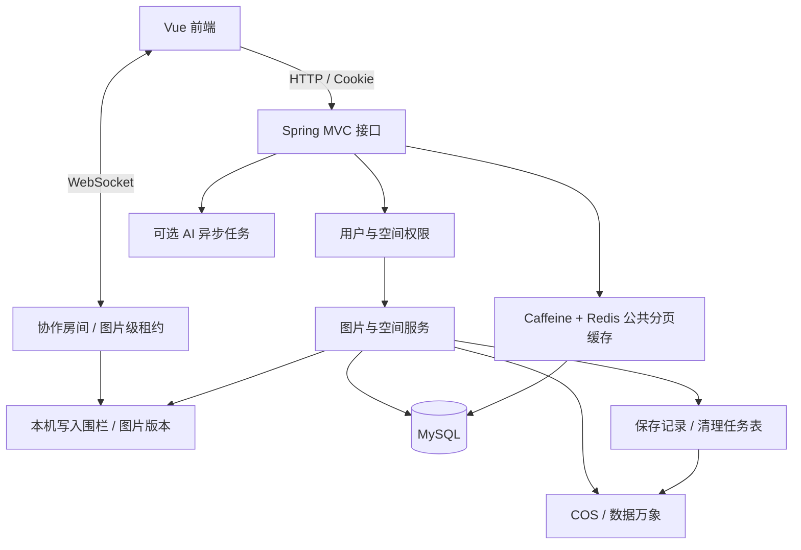

# 墨象协同云图库

面向公共图片素材、个人图片收藏和团队协作的前后端实践项目。基于 Vue 3、Spring Boot、MySQL、COS 与 WebSocket，覆盖图片从上传、审核、检索到协作编辑与保存的完整业务链路。

> 项目在云图库基础上进行改造和边界补全。当前完成本地业务验证，尚未部署公网；源码托管不代表生产安全验收或获得上游开源许可。

## 一分钟了解

1. **公共图库**：用户上传图片，管理员审核后展示，按名称、分类、标签等条件检索素材。
2. **个人空间**：按用户隔离图片管理入口，控制空间容量和数量，管理自己的图片集合。
3. **团队空间**：通过 viewer / editor / admin 分配权限；有编辑权限的成员获得图片级编辑锁，其他成员实时观察旋转与缩放，保存后同步已提交版本。

个人/团队空间的接口权限与 COS 对象访问策略是不同边界。使用公有读桶时，已知图片直链仍可能被直接读取；正式提供私密图库前须改造对象访问策略。

## 核心功能

| 模块 | 当前实现 |
| --- | --- |
| 用户 | 注册、登录、退出，HttpSession 会话与接口鉴权 |
| 图片 | 上传、图片信息解析、压缩/缩略图、审核、元数据修改、删除与分页检索 |
| 空间 | 个人/团队空间，成员管理、空间额度和团队 RBAC |
| 缓存 | 公共分页 Redis + Caffeine，查询条件/页码隔离、版本失效、随机 TTL |
| 协作 | WebSocket 图片级锁与租约，旋转/缩放广播，矩形裁剪及版本刷新 |
| 保存 | expectedRevision 冲突校验、requestId 幂等、事务额度更新、精确对象补偿清理 |
| AI 扩图 | 可选的异步扩图接口与任务查询；默认关闭，需自行配置模型服务并确认预算 |

目前没有完成分布式会话/协作锁、Disruptor、动态分表、完整统计分析、以图搜图或生产容量验证。

## 技术栈与架构

- 后端：Java、Spring Boot 2.7.6、MyBatis-Plus、MySQL、Redis、Caffeine、Sa-Token、WebSocket、COS/数据万象、Jsoup。
- 前端：Vue 3、TypeScript、Vite、Ant Design Vue、Pinia、Axios、OpenAPI 服务代码生成。
- 编译目标 Java 8；本地验证环境为 JDK 21.0.5。两者不能混同为已经完成 Java 8 运行兼容验证。



详见 [架构与关键流程](docs/ARCHITECTURE.md)。当前单实例设计，并未完成多实例协作。

## 快速开始

```sh
git clone https://github.com/richardxis/moxiang-gallery.git
cd moxiang-gallery
```

```text
backend/    后端业务、边界测试、建表与迁移、发布脚本
frontend/   前端业务、依赖锁定、环境变量示例
docs/       安装、架构、验证与限制、来源说明
```

先阅读 [安装与启动](docs/SETUP.md)，准备 MySQL、COS/数据万象；Redis 和 AI 根据开关启用。源码不带真实配置或测试账号密码。

后端构建：

```powershell
cd backend
mvn '-Dtest=*BoundaryTest' package
# 使用自己的外部私有配置，不把密钥放进仓库。
powershell -NoProfile -ExecutionPolicy Bypass -File .\release\start-local.ps1 -ConfigFile '自己的完整路径\application-local.yml'
```

前端启动（另开终端）：

```powershell
cd frontend
npm ci
if (-not (Test-Path .env.local)) { Copy-Item .env.example .env.local }
npm run dev
```

`VITE_API_BASE_URL` 只填后端 Origin，如 `http://localhost:8123`，不要再追加 `/api`。前后端使用同一主机名；所有 VITE_* 都可能进入浏览器，禁止填服务端密钥。

## 验证与限制

业务基线有 220 项边界回归、协作保存真实环境验证和 20 项真实 JAR 只读断言；本版本的新增配置测试、构建结果单独记录在 [验证说明](docs/VALIDATION.md)。这些是验证证据，不是生产用户数、QPS 或性能提升比例。

发布包排除真实 profile、.env 和私钥资源；新增 COS 配置校验在缺少配置时报告变量名，不回显秘密。前端生产构建不启用开发调试插件。

当前仍需完善文件隐私、密码哈希迁移、限流、会话安全、监控告警、备份恢复和多实例一致性。详见 [能力边界与路线图](docs/LIMITATIONS.md)。

## 来源与发布

参考的“智能协同云图库”，由此完成墨象版本的业务改造与测试补全。

见 [来源说明](docs/ATTRIBUTION.md)。
