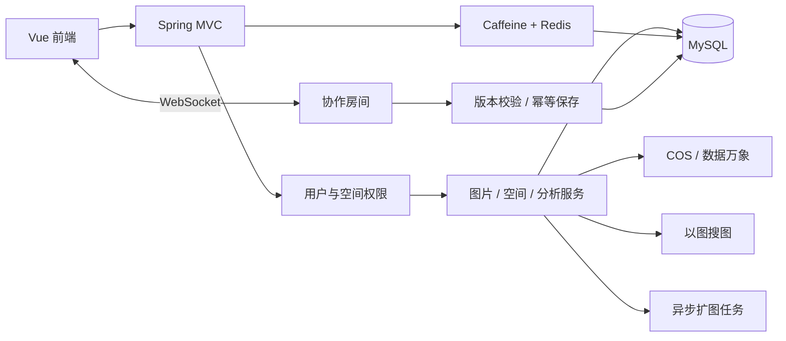

# 墨象协同云图库

面向个人与团队的图片素材管理平台，提供公共图库、个人空间和团队空间，覆盖图片上传、审核、检索、协作编辑、空间分析与 AI 扩图。

## 功能

| 模块 | 功能 |
| --- | --- |
| 图片管理 | 文件与 URL 上传、属性解析、压缩图、缩略图、审核、分页检索 |
| 空间管理 | 个人空间、团队空间、成员角色、容量与数量额度 |
| 图片检索 | 名称/分类/标签检索、主色相似度搜索、公共图片以图搜图 |
| 批量操作 | 多选图片修改分类、标签及命名规则，逐图版本校验与整批事务 |
| 图片分享 | 图片详情链接、链接复制与二维码，沿用原有访问权限 |
| 实时协作 | 图片级编辑租约、旋转/缩放同步、矩形裁剪与版本化保存 |
| 空间分析 | 使用量、分类、标签、大小分布、用户趋势、空间排行 |
| AI 扩图 | 任务创建、进度轮询、终态与异常处理 |
| 查询缓存 | Redis + Caffeine、分页条件隔离、共享版本失效、随机 TTL |

## 技术栈

- 后端：Java、Spring Boot、Spring MVC、MyBatis-Plus、MySQL。
- 缓存与权限：Redis、Caffeine、Sa-Token。
- 实时通信与存储：WebSocket、腾讯云 COS、数据万象。
- 图片搜索与 AI：Jsoup、百度识图、阿里云百炼。
- 前端：Vue 3、TypeScript、Vite、Ant Design Vue、Pinia、Axios。

## 架构



[架构与流程](docs/ARCHITECTURE.md) · [功能接口](docs/FEATURES.md) · [配置与启动](docs/SETUP.md)

## 快速开始

```sh
git clone https://github.com/richardxis/moxiang-gallery.git
cd moxiang-gallery
```

```text
backend/    接口、业务服务、测试、SQL 与部署脚本
frontend/   页面、组件、路由与 API 客户端
docs/       功能、架构、安装与部署文档
```

准备 MySQL、COS 与数据万象。Redis、AI 扩图及以图搜图按配置开关启用。完整配置见 [安装与启动](docs/SETUP.md)。

后端：

```powershell
cd backend
mvn '-Dtest=*BoundaryTest' package
powershell -NoProfile -ExecutionPolicy Bypass -File .\release\start-local.ps1 -ConfigFile '.\config\application-local.yml'
```

前端：

```powershell
cd frontend
npm ci
Copy-Item .env.example .env.local
npm run dev
```

前端 API 地址默认使用 `http://localhost:8123`。配置项 `VITE_API_BASE_URL` 填写服务地址，不附加 `/api`。

## 实现要点

- 公共分页将筛选、排序与页码纳入缓存键，写入提交后切换共享版本。
- 团队空间按角色授权，HTTP、WebSocket 与保存操作分别校验权限。
- 协作采用图片级连接租约，持久化版本与请求编号处理并发覆盖及重复保存。
- 批量编辑限制为同一图库、每批最多 100 张，任意版本冲突或写入失败均回滚整批。
- 分析使用数据库聚合；标签按游标分批读取，按关联图片去重统计。
- 分享打开图片详情页，空间图片仍需接收者拥有访问权限。

[测试说明](docs/VALIDATION.md) · [部署约束](docs/LIMITATIONS.md) · [致谢](docs/ATTRIBUTION.md)
