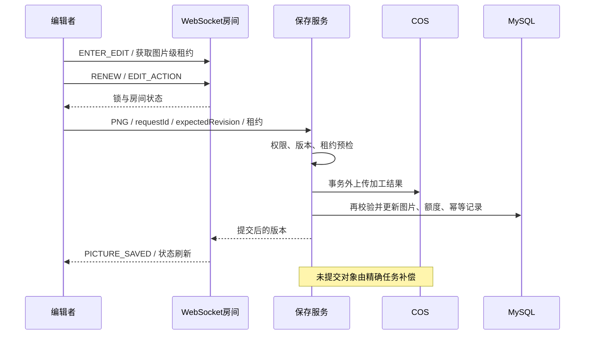

# 架构与关键流程

用户模块负责会话；图片模块负责上传、审核和检索；空间模块负责成员权限与额度；缓存模块只缓存公共查询；协作模块维护单实例房间和编辑租约；保存/清理模块负责版本、幂等与云对象补偿。这是业务分工，不表示完整 DDD 或微服务。

## 上传与缓存

上传链路：鉴权 → 文件/空间校验 → COS 上传与数据万象加工 → 读取图片信息 → 在写入校验和事务中更新图片、空间额度 → 推进公共缓存版本。

公共查询的规范化条件包含搜索字段、排序、页码和每页数量；空间查询不共用公开缓存。启用多级模式时查 Caffeine，再 Redis，最后数据库。共享版本限制本地旧结果，随机 TTL 降低同时过期风险。当前没有自动热点识别阈值。

## 协作与保存

锁粒度是图片 ID，所有已有图片写操作共享本机写入围栏。保存绑定用户/会话/连接，校验租约 token、epoch、草稿版本与 expectedRevision。裁剪先本地预览，保存后刷新已提交图片；不是像素合并、OT/CRDT 或分布式锁。

未知结果先查幂等记录或用相同 requestId 重试；不同载荷复用请求 ID 被拒绝。云对象不参与 MySQL 事务，补偿按精确 key 且检查有效引用，不猜测或盲删整个前缀。

API 鉴权与对象访问不同：公有读 COS 链接可直接读取，正式私有图库需改造读取和历史链接策略。
